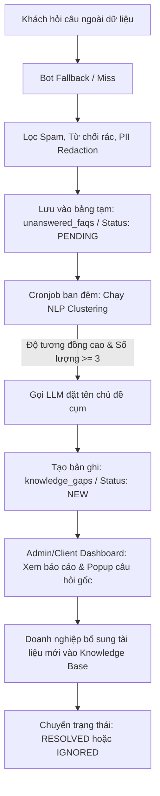
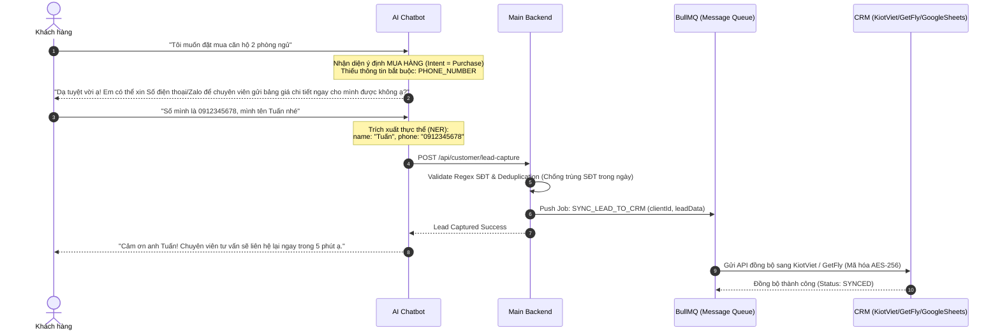
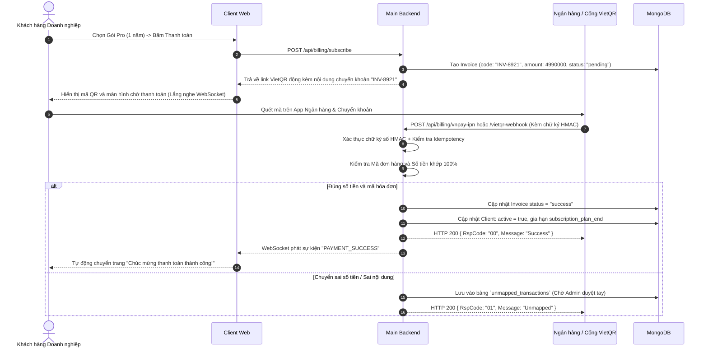

# Go QuestX - Tổng Hợp Đặc Tả Nghiệp Vụ & PRD (Product Requirements Catalog)

> **Dự án:** Go QuestX SaaS (B2B2C AI Chatbot & Conversational Commerce Platform)  
> **Nguồn tài liệu:** Thiết kế nghiệp vụ chính thức từ Đội ngũ Phân tích Nghiệp vụ (BA Team)  
> **Mục tiêu:** Lưu trữ, chuẩn hóa và chuyển hóa các yêu cầu nghiệp vụ (Business Rules) thành kiến trúc kỹ thuật phục vụ Backend Engineer / Backend Intern.

---

## 📌 Bảng Danh Mục 12 Phân Hệ Nghiệp Vụ Cốt Lõi

| STT | Tên Phân Hệ (PRD / Feature) | Mục tiêu nghiệp vụ cốt lõi | Trọng tâm kỹ thuật Backend |
| :---: | :--- | :--- | :--- |
| **01** | **[AI Auto-learning & Knowledge Gaps](#01-phân-tích-lỗ-hổng-kiến-thức-tự-động-ai-auto-learning--analytics)** | Phát hiện câu hỏi FAQ bot không trả lời được, gom cụm ngữ nghĩa tự động bằng cronjob để cảnh báo doanh nghiệp nạp thêm tài liệu. | Temporary table `unanswered_faqs`, Nightly Cronjob, Vector Similarity Clustering, LLM Topic Labeling, PII Redaction. |
| **02** | **[Omnichannel Integration](#02-tích-hợp-đa-kênh--mạng-xã-hội-omnichannel-integration)** | Kết nối Facebook Page, Instagram, Zalo OA; tự động trả lời inbox, bình luận và tự động ẩn bình luận chứa SĐT chống cướp khách. | Webhook HMAC SHA-256 (Meta) & MAC (Zalo), Idempotency qua `message_id`/`comment_id`, Phone Regex, Async Inbox dispatch. |
| **03** | **[Lead Capture & CRM Sync](#03-thu-thập-lead-tự-động-bằng-ai--đồng-bộ-crm)** | Trích xuất thông tin khách hàng (Tên, SĐT, Nhu cầu) từ ngữ cảnh chat tự nhiên bằng Slot-filling và đẩy sang CRM (KiotViet, GetFly, Google Sheets). | NER (Named Entity Recognition), Phone Regex, Deduplication, Async Message Queue (BullMQ), Retry mechanism. |
| **04** | **[Automated Payment & VietQR](#04-thanh-toán-tự-động-qua-vietqr-động--ipn-webhook)** | Tự động hóa thu phí B2B: sinh VietQR động theo đơn hàng (`INV-xxx`), đối soát 100% khớp tiền qua IPN Webhook ngân hàng và kích hoạt gói ngay lập tức. | IPN Webhook Verification, Exact Amount Match, Real-time Notification (WebSocket/Polling), Unmapped Transactions Queue. |
| **05** | **[Landing Page & Auth Gateway](#05-landing-page--cổng-xác-thực-auth-first-checkout)** | Phễu mua hàng định danh trước (Auth-first Checkout) tránh thanh toán mồ côi, Demo tương tác, bảng giá động, Google OAuth truyền `planId`. | Mongoose AuthLog, Brute-force lockout (5 fails), Google OAuth State Param, Post-login redirect with `selectedPlan`. |
| **06** | **[AI Commerce & Human Handoff](#06-ai-tư-vấn-lọc-nhu-cầu--chuyển-giao-cskh-conversational-commerce)** | Tư vấn sản phẩm bằng Carousel Rich-UI trong khung chat, lọc nhu cầu (Slot-filling), chuyển giao nhân viên CSKH khi khách muốn mua. | Product Catalog & Web Scraper (Draft -> Active), Anti-hallucination of price, SLA Timeout 3 mins fallback to Lead Form. |
| **07** | **[Sentiment Alert & SLA Handoff](#07-cảnh-báo-cảm-xúc--chuyển-giao-khẩn-cấp-sentiment-analysis)** | Nhận diện khách hàng tức giận (Sentiment < -0.5 hoặc từ khóa nhạy cảm), ngắt bot ngay lập tức, nháy chuông đỏ trên màn hình tư vấn viên. | Real-time WebSocket Alert, Bot Silence Enforcement, Meta 24h Messaging Window policy, Audit Log. |
| **08** | **[Broadcast Campaigns](#08-chiến-dịch-tương-tác-hàng-loạt-proactive-broadcast-campaigns)** | Gửi tin nhắn tiếp thị hàng loạt đa kênh (FB Messenger, Zalo OA) theo phân khúc khách hàng, có live preview, đặt lịch gửi và theo dõi tiến độ. | Distributed Queue (BullMQ/Redis), Cron Scheduler, Opt-out compliance, Rate Limiting, Failure & Retry metrics. |
| **09** | **[Subscription Lifecycle & Soft Downgrade](#09-vòng-đời-gói-cước--phân-bổ-tài-nguyên-subscription-lifecycle)** | Chuẩn hóa vòng đời B2B SaaS: Active -> Grace Period (3 ngày ân hạn, bot vẫn chạy) -> Downgraded (đóng băng tài nguyên, hạ cấp model) -> Auto Reactivate. | Grace Period state machine, Proration refund calculation, Resource freezing (padlock icon), Qdrant Vector Isolation. |
| **10** | **[Electronic Invoicing](#10-luồng-hóa-đơn-điện-tử-e-invoice---gqx-prd-einv-001-v21)** | Phát hành hóa đơn điện tử chuẩn: Biên nhận PDF cho cá nhân, Hóa đơn GTGT PDF + XML cho doanh nghiệp có tra cứu Mã số thuế (MST). | Idempotency Key, Immutable `paid`/`locked` state, Email Dispatch with 3 retries, MST verification integration. |
| **11** | **[Knowledge Base / AI Training Pipeline](#11-luồng-xử-lý-dữ-liệu-người-dùng-knowledge-base--ai-training)** | Upload tài liệu (.pdf, .docx, .txt, .csv) huấn luyện bot: S3 Upload -> Chunking -> OpenAI Embedding -> Lưu Qdrant DB. | File status lifecycle (PENDING -> PROCESSING -> READY -> FAILED -> INACTIVE), Hard Delete 3 tầng (DB, S3, Qdrant). |
| **12** | **[AI Writing Assistant & Persona Config](#12-trợ-lý-soạn-tin-ai-writing-assistant--cấu-hình-persona)** | Trợ lý hỗ trợ Agent soạn tin nhắn: sửa chính tả, cảnh báo giọng điệu, chặn cứng từ khóa nhạy cảm. Cấu hình Persona (GenZ, BĐS, Tech) và mã hóa API Key. | Debounce with `textVersion` (anti-stale), Send Rule Hard-block, Fail-safe graceful degradation, AES-256 API Key encryption. |

---

## 01. Phân Tích Lỗ Hổng Kiến Thức Tự Động (AI Auto-learning & Analytics)

### 1. Mục tiêu
Giải quyết triệt để bài toán **"Khoảng trống tri thức" (Knowledge Gaps)** bằng mô hình **Human-in-the-loop**: Khi Chatbot gặp câu hỏi FAQ không có trong dữ liệu nội bộ (fallback), hệ thống tự động gom nhóm các câu hỏi cùng chủ đề để Doanh nghiệp bổ sung tài liệu, giúp bot thông minh dần theo thời gian.

### 2. Quy trình 3 giai đoạn:


### 3. Quy chuẩn Backend:
- **Model `UnansweredFaq`:** `clientId`, `raw_question`, `redacted_question`, `session_id`, `status` (`pending`, `clustered`, `ignored`), `createdAt`.
- **Model `KnowledgeGap`:** `clientId`, `cluster_title`, `question_count`, `sample_questions` (mảng các câu hỏi gốc), `status` (`new`, `resolved`, `ignored`), `resolved_at`.
- **PII Redaction Regex:** Tự động che SĐT (`09xx***`), CCCD/CMND trước khi lưu hoặc gửi sang third-party LLM.

---

## 02. Tích Hợp Đa Kênh & Mạng Xã Hội (Omnichannel Integration)

### 1. Mục tiêu
Mở rộng Chatbot AI ra **Facebook Fanpage, Instagram, Zalo OA**. Tự động bảo vệ thông tin khách hàng, **chống đối thủ cướp khách** bằng cách tự động ẩn bình luận chứa số điện thoại.

### 2. Ma trận xử lý tự động:
1. **Tin nhắn riêng (Inbox Webhook):**  
   Nhận Webhook -> Main Backend xác thực chữ ký (HMAC SHA-256 cho Meta, MAC cho Zalo) -> Gọi AI RAG xử lý -> Gửi tin nhắn trả lời trực tiếp vào hộp thư của khách qua Graph API / Zalo OpenAPI.
2. **Bình luận thường (Public Comment):**  
   AI sinh câu trả lời lịch sự và tự động post comment công khai ngay dưới bình luận của khách.
3. **Bình luận chứa Số Điện Thoại (Comment with Phone):**  
   ```
   [Khách comment SĐT] 
        │
        ├──> (1) Quét Regex SĐT Việt Nam: /(03|05|07|08|09)\d{8}/
        ├──> (2) Gọi Meta Graph API ẨN BÌNH LUẬN NGAY LẬP TỨC (is_hidden = true)
        ├──> (3) Lưu thông tin Lead vào DB (Customer Model: phone, name, post_url)
        └──> (4) Bắn tin nhắn riêng (Private Message Inbox) tiếp cận và chăm sóc khách hàng
   ```

### 3. Yêu cầu kỹ thuật:
- **Idempotency (Chống xử lý trùng sự kiện):** Kiểm tra `message_id` hoặc `comment_id` qua Redis cache với TTL 24 giờ.
- **Thời gian phản hồi Webhook:** Phải trả HTTP `200 OK` cho Meta/Zalo trong vòng **< 2 giây** để tránh bị nhà mạng retry dồn dập.

---

## 03. Thu Thập Lead Tự Động Bằng AI & Đồng Bộ CRM

### 1. Mục tiêu
Thay thế Webform tĩnh gây nhàm chán bằng **AI Conversational Lead Capture**. AI tự nhận diện khách hàng đang quan tâm và khéo léo xin thông tin thông qua kỹ thuật **Slot-filling**.

### 2. Quy trình kỹ thuật:


---

## 04. Thanh Toán Tự Động Qua VietQR Động & IPN Webhook

### 1. Mục tiêu
Tự động hóa 100% quy trình thu phí B2B SaaS: Khách chọn gói -> Quét mã VietQR động -> Ngân hàng gửi Webhook -> Hệ thống kích hoạt gói cước ngay lập tức mà không cần nhân viên kế toán duyệt thủ công.

### 2. Luồng xử lý chi tiết:


---

## 05. Landing Page & Cổng Xác Thực (Auth-first Checkout)

### 1. Mục tiêu & Vấn đề giải quyết
- **Vấn đề "Thanh toán mồ côi":** Nếu cho khách thanh toán trước khi đăng ký tài khoản, khi có lỗi mạng hoặc khách tắt trình duyệt, tiền đã trừ nhưng không biết cấp tài khoản cho ai.
- **Giải pháp:** Áp dụng mô hình **Auth-first Checkout**: Khách bắt buộc phải Đăng ký / Đăng nhập trước khi thanh toán.

### 2. Cơ chế Handover & Redirect:
1. Tại Trang Bảng giá (`/pricing`), khách bấm "Mua ngay" gói Pro.
2. Frontend lưu `{ planId: "plan_pro_1y", billingCycle: "yearly" }` vào `localStorage`.
3. Chuyển hướng sang màn hình Xác thực (`/auth/login` hoặc `/auth/register`).
4. Nếu đăng nhập bằng **Google OAuth**: Hệ thống đính kèm `planId` vào tham số `state` của OAuth URL:
   `https://accounts.google.com/o/oauth2/v2/auth?state=plan_pro_1y&...`
5. Sau khi đăng nhập thành công, Backend đọc lại `state` (hoặc Frontend đọc `localStorage`) và tự động chuyển hướng thẳng vào:
   `/dashboard/billing?plan=plan_pro_1y`.

---

## 06. AI Tư Vấn, Lọc Nhu Cầu & Chuyển Giao CSKH (Conversational Commerce)

### 1. Mục tiêu
Biến Chatbot thành nhân viên bán hàng xuất sắc: Tư vấn chọn sản phẩm, hiển thị thẻ **Carousel sản phẩm** (ảnh, tên, giá, nút Mua), và chuyển giao cho nhân viên khi khách sẵn sàng chốt đơn.

### 2. Các quy tắc kinh doanh tối thượng:
- **Anti-Hallucination of Price (Chống bịa giá):** AI tuyệt đối **KHÔNG ĐƯỢC PHÉP** tự bịa giá sản phẩm bằng text. Mọi thông tin giá phải lấy từ Database sản phẩm và hiển thị qua Carousel Card.
- **Quy tắc Slot-filling làm rõ:** Tối đa **2 câu hỏi gạn lọc** (Ví dụ: "Bạn cần tìm hoa sinh nhật hay hoa khai trương?", "Ngân sách của bạn khoảng bao nhiêu?"). Không hỏi dồn dập làm phiền khách.
- **Độc quyền khung chat:** Khi trạng thái phiên là `human_handling`, Bot hoàn toàn bị câm (**Bot Silence**), không gửi tin nhắn chen ngang.
- **SLA Fallback (Timeout 3 phút):** Khi đã kích hoạt Handoff mà sau 3 phút không có nhân viên nào bấm nhận ca, Bot sẽ tự động thức dậy gửi Form thu thập thông tin để không bỏ lỡ khách hàng.

---

## 07. Cảnh Báo Cảm Xúc & Chuyển Giao Khẩn Cấp (Sentiment Analysis)

### 1. Vòng đời trạng thái hội thoại:
```
+--------------+      Sentiment < -0.5       +---------------+      Nhân viên bấm      +---------------+
|  Bot_Active  | --------------------------> |   Escalated   | ----------------------> | Human_Active  |
| (AI tự chat) |   hoặc từ khóa nhạy cảm     | (Nháy chuông) |       "Takeover"        | (Tắt bot hẳn) |
+--------------+                             +---------------+                         +---------------+
```

### 2. Quy tắc nghiệp vụ khẩn cấp:
- **Cảm xúc tiêu cực:** Khi điểm phân tích cảm xúc $Score < -0.5$ hoặc xuất hiện từ khóa: *"lừa đảo"*, *"gặp người thật"*, *"báo công an"*, *"tệ quá"* -> Chuyển ngay sang trạng thái `Escalated`.
- **Màn hình CSKH Console:** Màn hình của tư vấn viên lập tức đổi viền đỏ và phát âm thanh chuông cảnh báo.
- **Chính sách 24h Meta:** Nếu sau 24h kể từ tin nhắn cuối của khách trên Facebook/Instagram, hệ thống tự động khóa ô chat của nhân viên và cảnh báo chính sách Meta 24-hour messaging window.

---

## 08. Chiến Dịch Tương Tác Hàng Loạt (Proactive Broadcast Campaigns)

### 1. Mục tiêu
Cho phép doanh nghiệp chủ động gửi tin nhắn chăm sóc, khuyến mãi hàng loạt qua **Facebook Messenger** và **Zalo OA** theo phân khúc khách hàng (Leads, Đã mua hàng, Chưa phản hồi).

### 2. Kiến trúc hàng đợi Backend:
- **Distributed Queue (BullMQ + Redis):** Không gửi bằng vòng lặp `for` thông thường vì sẽ làm nghẽn server và bị nhà mạng Facebook/Zalo khóa API do vượt Rate Limit.
- **Rate Limiting & Throttle:** Giới hạn tốc độ gửi (VD: tối đa 30 tin/giây trên Zalo OA, 50 tin/giây trên Facebook).
- **Hỗ trợ điều khiển:** Cho phép Tạm dừng (`pause`), Tiếp tục (`resume`), hoặc Hủy lịch (`cancel`).
- **Tuân thủ Opt-out:** Nếu khách hàng từng nhắn "Dừng nhận tin" hoặc "Unsubscribe", hệ thống tự động loại khỏi danh sách gửi.

---

## 09. Vòng Đời Gói Cước & Phân Bổ Tài Nguyên (Subscription Lifecycle)

### 1. Máy trạng thái (State Machine):
```
[ ACTIVE ] ──(Đến ngày hết hạn)──> [ GRACE_PERIOD (3 ngày ân hạn) ] ──(Hết 3 ngày)──> [ DOWNGRADED (Hạ cấp mềm) ]
    ↑                                      │                                                   │
    └──────────────────────────────────────┴───────────────────────────────────────────────────┘
                                   (Khách hàng nạp tiền gia hạn)
```

### 2. Chi tiết từng trạng thái:
- **`ACTIVE`:** Đầy đủ tính năng theo hạn mức gói.
- **`GRACE_PERIOD` (3 ngày ân hạn):**
  - Kích hoạt khi tài khoản hết hạn dưới 3 ngày.
  - **Triết lý B2B:** Dashboard của Client bị mờ (Read-only) và hiện Banner đỏ nhắc nợ, **nhưng Chatbot ngoài Website của họ vẫn hoạt động 100%** để khách hàng không bị đứt gãy kinh doanh.
- **`DOWNGRADED` (Hạ cấp mềm về Basic):**
  - Quá 3 ngày không thanh toán.
  - Tài khoản tự động đưa về Gói Cơ Bản. Các file tài liệu hoặc nhân viên vượt hạn mức sẽ bị "đóng băng" (trạng thái `disabled`, gắn icon ổ khóa). Model AI bị hạ xuống phiên bản cơ bản.
- **`Auto-Reactivate` (Mở khóa tự động khi nạp tiền):**
  - Khi khách thanh toán thành công, hệ thống tự động mở khóa các tài liệu bị đóng băng theo thứ tự ưu tiên tài liệu mới nhất.
- **Proration (Bù trừ tiền nâng cấp gói):**
  Số tiền cần trả = $\text{Giá gói mới} - \left( \frac{\text{Giá gói cũ}}{\text{Tổng ngày}} \times \text{Số ngày chưa sử dụng} \right)$.

---

## 10. Luồng Hóa Đơn Điện Tử (E-Invoice - GQX-PRD-EINV-001 v2.1)

### 1. Phân nhánh đối tượng:
- **Khách hàng Cá nhân:** Nhận Biên nhận thanh toán điện tử (Receipt PDF) qua email.
- **Khách hàng Doanh nghiệp:** Khai báo Tên công ty, Địa chỉ và **Mã số thuế (MST)** (hệ thống có API tra cứu tự động tên công ty theo MST) -> Xuất hóa đơn GTGT điện tử gồm 2 định dạng: **PDF** (bản thể hiện) và **XML** (dữ liệu hóa đơn có chữ ký số).

### 2. Tính bất biến (Immutability):
- Hóa đơn một khi đã chuyển sang trạng thái `paid` hoặc `locked` thì **TUYỆT ĐỐI KHÔNG ĐƯỢC CHỈNH SỬA** thông tin xuất hóa đơn.
- Gửi hóa đơn qua email có cơ chế thử lại tối đa 3 lần (`max_retries = 3`), sử dụng `Idempotency-Key` để không xuất hóa đơn trùng lặp.

---

## 11. Luồng Xử Lý Dữ Liệu Người Dùng (Knowledge Base Pipeline)

### 1. Vòng đời tệp tin (`ClientFile`):
```
[PENDING] ──> [PROCESSING] ──> [READY] (AI đã học xong)
                   │
                   └──(Lỗi định dạng/file hỏng)──> [FAILED]
```
*(Nếu gói cước bị hạ cấp, file chuyển thành `INACTIVE` / Frozen).*

### 2. Cơ chế Hard Delete triệt để 3 tầng:
Khi Client xóa một tài liệu tri thức, Backend phải thực thi dọn dẹp triệt để trên cả 3 hệ thống để chống hiện tượng **ảo giác tri thức từ dữ liệu cũ**:
1. **Tầng 1 (Database MongoDB):** Xóa bản ghi `knowledge_files`.
2. **Tầng 2 (Cloud Storage):** Xóa file nhị phân vật lý trên **AWS S3 / Local Storage**.
3. **Tầng 3 (Vector DB):** Gửi lệnh xóa toàn bộ các điểm Vector tương ứng với `file_id` trên **Qdrant DB / ChromaDB**.

---

## 12. Trợ Lý Soạn Tin (AI Writing Assistant) & Cấu Hình Persona

### 1. Trợ lý soạn tin thời gian thực (Composer Assistant):
- **Cơ chế Debounce & `textVersion`:** Khi nhân viên dừng gõ phím 500ms, AI phân tích chính tả và phong cách. Mỗi lần gõ tăng `textVersion`. Nếu kết quả AI trả về có `textVersion` cũ hơn text hiện tại trong ô gõ, hệ thống tự động hủy kết quả để tránh ghi đè dữ liệu cũ (**Anti-stale**).
- **Quy tắc Send Rule / Hard Block:** Nếu phát hiện từ khóa nghiêm trọng thuộc danh mục cấm (ví dụ: cam kết sai sự thật, từ ngữ miệt thị), nút **Gửi** và phím **Enter** sẽ bị khóa cứng cho đến khi nhân viên sửa lại.
- **Cơ chế Fail-safe:** Nếu AI service bị lỗi hoặc quá tải, ô soạn thảo của nhân viên vẫn hoạt động bình thường, không bao giờ làm gián đoạn việc chat.

### 2. Cấu hình Cá tính Chatbot (Persona):
- Hỗ trợ các Presets sẵn: **GenZ** (năng động, nhiều emoji), **Bất động sản** (lịch sự, trang trọng, chuyên nghiệp), **Công nghệ** (ngắn gọn, chính xác).
- Hỗ trợ custom system prompt và cấu hình xưng hô (Em - Anh/Chị, Mình - Bạn).
- Mã hóa API Key nhà cung cấp bằng thuật toán **AES-256-CBC**, khi hiển thị cho người dùng luôn mask dạng: `sk-proj-****-1234`.
