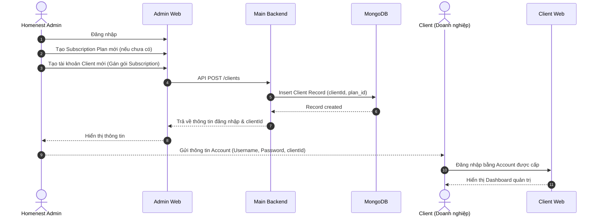
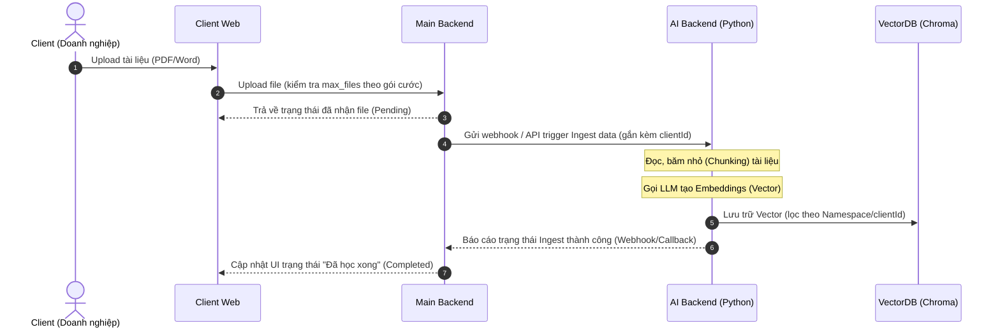
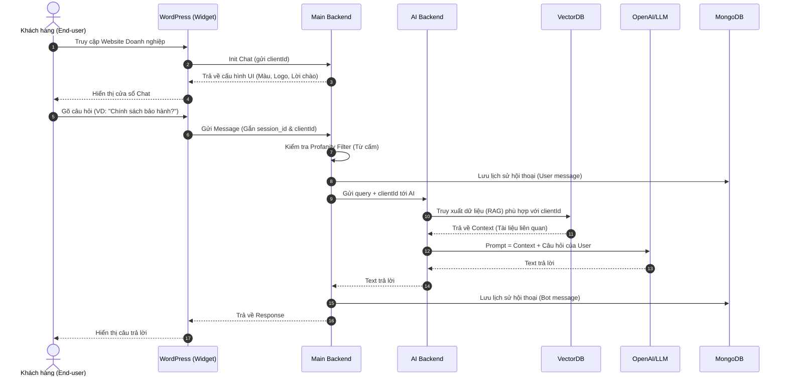

# Go QuestX - Master Specification & Business Analysis (BA) Document

> **Dự án:** Go QuestX SaaS (B2B2C AI Chatbot Platform)  
> **Phiên bản:** 1.0.0  
> **Mục tiêu:** Hệ thống tài liệu đặc tả chuẩn "Docs as Code" đồng bộ giữa Kỹ thuật, Kinh doanh, Quản trị và QA/QC.

---

## 📌 Bảng mục lục
1. [Tổng quan dự án & BRD (Business Requirements Document)](#1-tài-liệu-yêu-cầu-nghiệp-vụ-brd)
2. [Đặc tả kỹ thuật & SRS (Software Requirements Specification)](#2-đặc-tả-yêu-cầu-hệ-thống-srs)
3. [Luồng người dùng trực quan (User Flows)](#3-luồng-người-dùng-user-flows)
4. [Danh mục Use Cases & User Stories](#4-use-cases-và-user-stories)
5. [Tiêu chí nghiệm thu (Acceptance Criteria cho QA/QC & Dev)](#5-tiêu-chí-nghiệm-thu-acceptance-criteria)
6. [Hướng dẫn nhúng Widget Chatbot (Embedding Guides)](#6-hướng-dẫn-nhúng-chatbot-embedding-guides)

---

## 1. Tài liệu Yêu cầu Nghiệp vụ (BRD)

### 1.1. Mục tiêu Dự án (Project Objectives)
Xây dựng nền tảng SaaS (Software as a Service) cung cấp giải pháp **Chatbot AI nhúng (Widget)** cho website WordPress và các nền tảng web hiện đại.
Hệ thống cho phép **Homenest** kinh doanh gói dịch vụ Chatbot định kỳ (Subscription). Khách hàng doanh nghiệp B2B (Clients) sau khi mua gói sẽ được cung cấp bảng điều khiển quản trị riêng biệt để:
- Tải tài liệu nội bộ (PDF, Word) để "huấn luyện" AI riêng biệt cho doanh nghiệp (kỹ thuật RAG - Retrieval-Augmented Generation).
- Tùy chỉnh nhận diện thương hiệu cho Chatbot Widget (Màu sắc, Logo, Tin nhắn chào mừng).
- Nhúng Chatbot vào Website của họ để trả lời tự động cho khách hàng truy cập (End-user).
- Xem lịch sử trò chuyện và thu thập dữ liệu khách hàng tiềm năng (Leads).

### 1.2. Phạm vi Dự án (Project Scope)
Gồm 4 phân hệ chính:
1. **Homenest Admin Web:** Portal quản trị trung tâm của Homenest để quản lý toàn bộ Client và các gói cước Subscription.
2. **Client Web (Tenant Dashboard):** Portal dành riêng cho từng Client (Doanh nghiệp) để quản lý nhân viên (Users), cấu hình API Key, tùy biến Widget, tải tài liệu tri thức (Knowledge Base) và xem báo cáo/Leads.
3. **Backend Services (Node.js & MongoDB):** Xử lý nghiệp vụ SaaS, phân quyền đa người thuê (Multi-tenant isolation), quản lý gói cước & giới hạn hạn mức (Quota), lưu trữ lịch sử chat & khách hàng tiềm năng.
4. **AI Backend (Python & FastAPI):** Xử lý băm nhỏ tài liệu (Chunking), nhúng vector (Embeddings Ingestion), truy xuất ngữ cảnh (Retrieval) dựa trên tài liệu riêng của từng Client từ ChromaDB và sinh phản hồi cùng LLM (OpenAI, Gemini, Claude).
5. **Chatbot Widget (React / Vite):** Cửa sổ chat nhỏ gọn được build thành bundle JS/CSS độc lập, hỗ trợ nhúng dạng Script hoặc Iframe trên WordPress và web bất kỳ.

### 1.3. Các thực thể nghiệp vụ (Business Entities)
- **Super Admin (Homenest Team):** Quản trị viên tối cao, toàn quyền tạo tài khoản Client, cấu hình các gói Subscription (giới hạn số người dùng, số lượng file, thời hạn).
- **Client (Tenant - Doanh nghiệp):** Khách hàng B2B mua gói dịch vụ. Mỗi Client có một `clientId` duy nhất. Quản lý cấu hình riêng: API Key, Domain cho phép, Màu sắc Widget, Tin nhắn mở đầu, Bộ lọc từ ngữ nhạy cảm (Profanity filter). Giới hạn theo gói `SubscriptionPlan`.
- **User (Employee - Nhân viên):** Nhân viên do Client tạo ra trong Tenant Dashboard để hỗ trợ quản trị, xem lịch sử chat và huấn luyện tài liệu.
- **End-Customer (Khách hàng cuối):** Người truy cập website của Client, tương tác với Chatbot Widget, nhận tư vấn và có thể để lại thông tin liên hệ (Leads).

### 1.4. Mô hình Kinh doanh & Triển khai
- **Mô hình:** B2B SaaS trả phí định kỳ (Subscription Plans: Basic, Pro, Enterprise,...).
- **Triển khai:** Đóng gói Docker & Docker-compose trên VPS độc lập.
- **An toàn dữ liệu:** Cô lập logic dữ liệu bằng trường `clientId` trong toàn bộ hệ thống cơ sở dữ liệu (Data Isolation).

---

## 2. Đặc tả Yêu cầu Hệ thống (SRS)

### 2.1. Kiến trúc Hệ thống Tổng thể
- **Frontend Clients (Next.js & React):**
  - `admin-web`: Quản trị Super Admin.
  - `client-web`: Dashboard cho Doanh nghiệp (Tenant).
  - `chatbot`: Widget UI (Build bằng Vite/React ra bundle JS/CSS độc lập).
- **Main Backend (Node.js + Express + REST / GraphQL):**
  - Quản lý xác thực JWT, phân quyền RBAC.
  - CRUD nghiệp vụ, quản lý Subscription & Quota Limits.
  - CSDL: MongoDB (Mongoose ODM).
- **AI Backend (Python + FastAPI):**
  - RAG Ingestion Pipeline & Vector Search.
  - Cơ sở dữ liệu Vector: ChromaDB (Namespaced theo `clientId`).
  - Tích hợp mô hình ngôn ngữ lớn (OpenAI GPT, Google Gemini, Anthropic Claude).

### 2.2. Cấu trúc Cơ sở dữ liệu cốt lõi (Core Data Models)

#### 1. `admins`
Lưu trữ tài khoản Super Admin của Homenest.
```json
{
  "_id": "ObjectId",
  "username": "admin",
  "password": "hashed_password",
  "name": "Super Administrator",
  "avatar": "https://...",
  "createdAt": "ISODate"
}
```

#### 2. `subscriptionplans`
Định nghĩa các gói cước và giới hạn tài nguyên.
```json
{
  "_id": "ObjectId",
  "name": "Pro Plan",
  "max_users": 10,
  "max_files": 20,
  "duration_days": 30,
  "price": 499000,
  "description": "Dành cho doanh nghiệp vừa và nhỏ",
  "isActive": true
}
```

#### 3. `clients`
Định danh doanh nghiệp (Tenant).
```json
{
  "_id": "ObjectId",
  "clientId": "client_abc123xyz",
  "company_name": "Công ty TNHH Mẫu",
  "email": "contact@company.com",
  "password": "hashed_password",
  "subscription_plan_id": "ObjectId(SubscriptionPlan)",
  "subscription_plan_end": "2026-12-31T23:59:59Z",
  "status": "active", // active | inactive | suspended
  "widget_config": {
    "color": "#2563eb",
    "action_color": "#1d4ed8",
    "avatar": "https://...",
    "welcome_message": "Xin chào! Tôi có thể giúp gì cho bạn hôm nay?",
    "allowed_domains": ["https://mycompany.com"],
    "require_lead_form": true,
    "profanity_words": ["lừa đảo", "chửi bậy"]
  },
  "api_keys": {
    "openai": "encrypted_string",
    "gemini": "encrypted_string"
  },
  "createdAt": "ISODate"
}
```

#### 4. `users`
Nhân viên thuộc quyền quản trị của Client.
```json
{
  "_id": "ObjectId",
  "clientId": "client_abc123xyz",
  "username": "staff_01",
  "email": "staff@company.com",
  "password": "hashed_password",
  "fullName": "Nguyễn Văn A",
  "role": "staff", // admin | staff
  "createdAt": "ISODate"
}
```

#### 5. `knowledge_files`
Quản lý tài liệu đưa vào huấn luyện AI.
```json
{
  "_id": "ObjectId",
  "clientId": "client_abc123xyz",
  "file_name": "Bang_Gia_2026.pdf",
  "file_url": "https://...",
  "file_size": 2048500,
  "status": "completed", // pending | processing | completed | failed
  "vector_count": 48,
  "uploadedBy": "ObjectId(User)",
  "createdAt": "ISODate"
}
```

#### 6. `chats` & `messages`
Lưu trữ phiên hội thoại giữa End-User và Chatbot.
```json
// chats (phiên hội thoại)
{
  "_id": "ObjectId",
  "clientId": "client_abc123xyz",
  "sessionId": "sess_987654321",
  "customer_id": "ObjectId(Customer) | null",
  "lastMessageAt": "ISODate",
  "createdAt": "ISODate"
}

// messages (chi tiết tin nhắn)
{
  "_id": "ObjectId",
  "clientId": "client_abc123xyz",
  "sessionId": "sess_987654321",
  "sender": "user", // user | bot
  "content": "Giá gói Basic là bao nhiêu?",
  "createdAt": "ISODate"
}
```

#### 7. `customers`
Khách hàng tiềm năng (Leads) gửi thông tin từ Widget.
```json
{
  "_id": "ObjectId",
  "clientId": "client_abc123xyz",
  "sessionId": "sess_987654321",
  "name": "Trần Thị B",
  "phone": "0987654321",
  "email": "tranthib@gmail.com",
  "createdAt": "ISODate"
}
```

### 2.3. Yêu cầu Chức năng (Functional Requirements)
- **Homenest Admin:**
  - `[FR-A01]` Đăng nhập xác thực JWT.
  - `[FR-A02]` Quản lý SubscriptionPlan (Thêm, Sửa, Xóa, Gán gói).
  - `[FR-A03]` Tạo tài khoản Client mới và cấp phát `clientId`.
- **Client (Tenant):**
  - `[FR-C01]` Đăng nhập bằng tài khoản được cấp.
  - `[FR-C02]` Xem giới hạn cấu hình gói cước và thời hạn còn lại.
  - `[FR-C03]` Quản lý nhân viên (Validate không vượt quá `max_users`).
  - `[FR-C04]` Tùy biến giao diện Widget (Màu sắc, Logo, Lời chào).
  - `[FR-C05]` Cấu hình API Key nhà cung cấp AI (Mã hóa bảo mật).
  - `[FR-C06]` Tải tài liệu huấn luyện AI (Validate không vượt quá `max_files`, gọi Ingestion sang AI Backend).
  - `[FR-C07]` Quản lý lịch sử hội thoại và danh sách khách hàng tiềm năng (Leads).
- **Chatbot Widget:**
  - `[FR-W01]` Tự động tải config UI dựa theo `clientId` khi khởi tạo.
  - `[FR-W02]` Chat trực tiếp phản hồi nhanh.
  - `[FR-W03]` Thu thập thông tin khách hàng (Lead Generation Form) nếu bật cấu hình.
  - `[FR-W04]` Hiển thị trạng thái đang soạn câu trả lời (Typing Indicator).
  - `[FR-W05]` Lọc và chặn từ ngữ vi phạm theo `profanity_words` của Client.

### 2.4. Yêu cầu Phi chức năng (Non-Functional Requirements)
- **Data Isolation:** Tuyệt đối mọi thao tác nghiệp vụ của Client và Widget phải bắt buộc có `clientId`. Không bao giờ query mà thiếu bộ lọc `clientId`.
- **Hiệu năng:** Độ trễ API Widget < 3s (không tính độ trễ phụ thuộc từ nhà cung cấp LLM).
- **Bảo mật:** Mã hóa API Key của Client bằng AES-256 trước khi lưu vào database.

---

## 3. Luồng Người Dùng (User Flows)

### 3.1. Luồng Cấp Phát Tài Khoản (Onboarding Flow)



### 3.2. Luồng Huấn Luyện AI (Knowledge Ingestion Flow)



### 3.3. Luồng Chat của Khách Hàng (Chatbot End-User Flow)



---

## 4. Use Cases và User Stories

### Module 1: Quản trị Hệ thống (Super Admin)
- **UC-01 (Tạo Gói cước):** Là Super Admin, tôi muốn tạo gói cước dịch vụ (Basic, Pro) với các thông số (`max_users`, `max_files`, giá, hạn sử dụng) để bán cho khách hàng.
- **UC-02 (Cập nhật Gói cước):** Là Super Admin, tôi muốn chỉnh sửa gói cước để cập nhật chiến lược kinh doanh.
- **UC-03 (Cấp phát tài khoản Client):** Là Super Admin, tôi muốn tạo tài khoản Doanh nghiệp mới và gán gói cước cho họ.
- **UC-04 (Khóa/Mở khóa Client):** Là Super Admin, tôi muốn tạm ngưng tài khoản Client khi hết hạn hoặc vi phạm.

### Module 2: Quản lý Khách hàng Thuê (Tenant Dashboard)
- **UC-05 (Tùy chỉnh Widget):** Là Client, tôi muốn tùy chỉnh màu sắc và Avatar cho bot để phù hợp nhận diện thương hiệu.
- **UC-06 (Cài đặt Lời chào):** Là Client, tôi muốn tự định nghĩa tin nhắn mở đầu xuất hiện khi khách mở bot.
- **UC-07 (Cấu hình API Key):** Là Client, tôi muốn nhập API Key OpenAI/Gemini của công ty tôi để tự chịu chi phí token.
- **UC-08 (Upload tài liệu RAG):** Là Client, tôi muốn upload file PDF/DOCX để bot học tri thức riêng của công ty.
- **UC-09 (Xem trạng thái tài liệu):** Là Client, tôi muốn theo dõi tiến trình xử lý của file (Pending -> Processing -> Completed/Failed).
- **UC-10 (Xem Lịch sử Chat):** Là Client/Staff, tôi muốn duyệt toàn bộ tin nhắn trò chuyện theo từng phiên (`session_id`).
- **UC-11 (Thu thập Leads):** Là Client, tôi muốn thu thập tên, SĐT, email của khách hàng tiềm năng.

### Module 3: Chatbot Widget (End-User)
- **UC-12 (Tương tác Chat):** Là Khách truy cập web, tôi muốn nhận được câu trả lời chính xác, nhanh chóng theo tri thức của doanh nghiệp.
- **UC-13 (Chặn từ ngữ nhạy cảm):** Là Hệ thống, phát hiện câu hỏi chứa từ cấm trong bộ lọc và từ chối trả lời lịch sự.

---

## 5. Tiêu chí Nghiệm thu (Acceptance Criteria)

### ✅ AC 1: Khởi tạo Client và Phân quyền
- **AC 1.1:** Admin nhập đầy đủ Tên, Email/Username, Password và chọn Gói cước -> Bấm Lưu -> Bản ghi `clients` được tạo với `clientId` duy nhất.
- **AC 1.2:** Thiếu trường bắt buộc -> Form báo lỗi validation màu đỏ, nút Lưu bị disable.
- **AC 1.3:** Client dùng thông tin được cấp đăng nhập thành công vào Client Web và thấy đúng hạn mức gói.

### ✅ AC 2: Kiểm soát giới hạn Gói cước (Subscription Limits)
- **AC 2.1 (Max Users):** Gói cho phép 5 Users. Khi cố tạo User thứ 6, API trả về lỗi và UI hiển thị: *"Bạn đã đạt giới hạn số lượng người dùng của gói cước hiện tại."*
- **AC 2.2 (Max Files):** Gói cho phép 10 files. Khi tải lên file thứ 11, API trả về `403 Forbidden` kèm thông báo vượt quá số lượng cho phép.
- **AC 2.3 (Hết hạn):** Nếu `Date.now() > subscription_plan_end`, đăng nhập sẽ bị yêu cầu gia hạn và API Widget trả về trạng thái ngưng hoạt động.

### ✅ AC 3: Quá trình Huấn luyện AI (RAG Ingestion)
- **AC 3.1:** Upload PDF hợp lệ (< 10MB) -> File vào DB với trạng thái `processing`.
- **AC 3.2:** AI Backend xử lý xong và gọi Webhook -> Trạng thái file chuyển thành `completed`.
- **AC 3.3:** Upload file không hỗ trợ (`.exe`, `.mp4`) -> Frontend chặn ngay từ bước chọn file.

### ✅ AC 4: Tương tác Chatbot và Cách ly Dữ liệu (Data Isolation)
- **AC 4.1 (UI Isolation):** Widget truyền `clientId` của Công ty A -> Tải đúng màu sắc, avatar, welcome message của A.
- **AC 4.2 (AI Isolation):** Hỏi bot công ty A -> RAG chỉ truy xuất Vector trong namespace của `clientId` A, tuyệt đối không lấy dữ liệu công ty B.
- **AC 4.3 (Profanity Filter):** Gặp từ khóa cấm -> Bot lập tức từ chối trả lời bằng câu cảnh báo cấu hình sẵn.

### ✅ AC 5: Lịch sử Chat và Bảo mật API
- **AC 5.1:** Lịch sử lưu kèm `sessionId` để gom nhóm các tin nhắn trong cùng 1 phiên.
- **AC 5.2:** Client A xem lịch sử chat -> Chỉ trả về dữ liệu có `clientId = A`. Nếu sửa query thành Client B -> Báo lỗi `403 Forbidden`.

---

## 6. Hướng dẫn Nhúng Chatbot (Embedding Guides)

### 6.1. Nhúng vào WordPress
- **Cách 1 (Plugin chính thức):** Cài đặt file plugin `goquestx-chatbot.zip`, vào trang cấu hình nhập `clientId` và bấm Lưu.
- **Cách 2 (Script HTML chèn vào Footer):**
```html
<script 
  src="https://cdn.goquestx.com/widget.js" 
  data-client-id="YOUR_CLIENT_ID" 
  defer>
</script>
```

### 6.2. Nhúng vào React / Next.js
Dùng thẻ Script của Next.js hoặc useEffect:
```tsx
import Script from 'next/script';

export default function ChatWidget() {
  return (
    <Script
      src="https://cdn.goquestx.com/widget.js"
      data-client-id="YOUR_CLIENT_ID"
      strategy="lazyOnload"
    />
  );
}
```

### 6.3. Nhúng vào Vue 3
```vue
<template>
  <div id="goquestx-container"></div>
</template>

<script setup>
import { onMounted } from 'vue';

onMounted(() => {
  const script = document.createElement('script');
  script.src = 'https://cdn.goquestx.com/widget.js';
  script.setAttribute('data-client-id', 'YOUR_CLIENT_ID');
  script.defer = true;
  document.body.appendChild(script);
});
</script>
```
